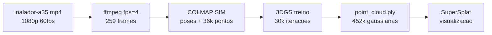

# Reconstrução 3D do Inalador — Gaussian Splatting

## Resumo

A reconstrução está **concluída**: 33,73 dB de PSNR sobre 452.802 gaussianas, a partir de 259 frames de um vídeo de celular de 65 segundos.

O objeto é um inalador vintage de esmalte verde, filmado em órbita com um Galaxy A35. O pipeline usou dois algoritmos encadeados: **COLMAP** (Structure-from-Motion) para estimar as poses de câmera, e **3D Gaussian Splatting** (Kerbl et al., SIGGRAPH 2023) para o campo de radiância.

| Métrica | Valor |
| --- | --- |
| PSNR | 33,73 dB |
| SSIM | 0,9696 |
| LPIPS | 0,1738 |
| Gaussianas finais | 452.802 |
| Imagens registradas | 259 / 259 (100%) |
| Erro de reprojeção | 0,86 px |
| Arquivo final | 107,1 MB |

PSNR acima de 33 dB com SSIM de 0,97 indica reconstrução de alta fidelidade. O gargalo do projeto não foi o algoritmo nem o hardware — foi conseguir o arquivo de vídeo original sem recompressão.

## Ambiente

Todo o pipeline roda local, sem nuvem. As versões abaixo foram verificadas na máquina, não assumidas.

| Componente | Versão / valor | Caminho |
| --- | --- | --- |
| GPU | RTX 5060 Ti · 15,9 GiB · 36 SMs · 180 W | Blackwell, compute capability 12.0 |
| Driver NVIDIA | 610.62 | — |
| COLMAP | 4.1.1 com CUDA (commit a0d785f) | `C:\Projetos3D\colmap\bin\colmap.exe` |
| ffmpeg | 8.1.2-essentials | `C:\ffmpeg\ffmpeg-8.1.2-essentials_build\bin` |
| PyTorch | 2.13.0+cu130 (CUDA 13.0) | env conda `gaussian_splatting` |
| Repositório 3DGS | INRIA, versão 2024 | `C:\Projetos3D\gaussian-splatting` |

### Submódulos CUDA compilados

| Módulo | Estado |
| --- | --- |
| `diff_gaussian_rasterization` | instalado — **build padrão** |
| `simple_knn` | instalado |
| `fused_ssim` | instalado (acelera o cálculo do SSIM na loss) |

A build do rasterizador é a padrão, não a acelerada `3dgs_accel`. Ela expõe apenas `GaussianRasterizationSettings`, `GaussianRasterizer` e `rasterize_gaussians` — sem o símbolo `SparseGaussianAdam`. Isso teve consequência prática no treino, registrada mais adiante.

O interpretador do ambiente deve ser chamado pelo caminho completo, `C:\Users\eronp\.conda\envs\gaussian_splatting\python.exe`, o que dispensa `conda activate` e evita rodar no env `base` por engano.

## O material de origem

Três arquivos foram avaliados antes de um servir. Conseguir o vídeo original consumiu mais tempo que todo o resto do pipeline.

| Arquivo | Resolução | Bitrate | Tamanho | Veredito |
| --- | --- | --- | --- | --- |
| `inalador-celular.mp4` | 848×478 | 1,74 Mbps | 13,5 MB | Recomprimido pelo WhatsApp |
| `inalador-a35.mp4` (1º download) | indeterminável | — | 2,1 MB | Download truncado, ilegível |
| `inalador-a35.mp4` (íntegro) | **1920×1080** | **27,7 Mbps** | **216,2 MB** | Aprovado |

Os dois arquivos válidos têm duração idêntica (64,8059 s) e a mesma contagem de frames (3.886). Isso prova que são **a mesma gravação** — o primeiro era apenas a versão destruída pela recompressão, com 5× menos pixels e 16× menos dados.

### O download truncado

O segundo arquivo não abria: `moov atom not found`. A análise dos bytes explicou por quê.

- O box `ftyp` estava intacto (`mp42` / `isom`).
- O box `mdat`, com tamanho estendido de 64 bits, declarava **226.626.047 bytes** — mas só 2.150.365 estavam no disco, ou seja **0,95% do arquivo**.
- O atom `moov`, que guarda resolução, fps e a tabela de frames, estava ausente. Câmeras de celular gravam esse índice no **fim** do arquivo, então um download interrompido deixa o vídeo sem cabeçalho.
- Tentei recuperar a resolução direto do fragmento H.264, mas o stream usa formato AVCC, sem SPS/PPS inline — esses parâmetros também vivem no `moov`.

A causa provável foi o aviso de antivírus do Google Drive em arquivos grandes: fechar a aba durante o download deixa um arquivo parcial sem erro visível.

### Verificação de qualidade do arquivo aprovado

Além do cabeçalho, medi a nitidez real de cinco frames amostrados ao longo do vídeo, pela variância do Laplaciano. Na região do objeto os valores ficaram entre **88 e 185**, consistentes e sem motion blur relevante.

| Timestamp | Nitidez (frame inteiro) | Nitidez (objeto) | Brilho médio |
| --- | --- | --- | --- |
| 5 s | 65,1 | 185,4 | 129,8 |
| 20 s | 39,6 | 88,2 | 111,9 |
| 35 s | 50,1 | 118,1 | 125,5 |
| 50 s | 49,8 | 117,5 | 140,4 |
| 62 s | 32,6 | 100,7 | 141,5 |

A inspeção visual confirmou uma órbita real, com múltiplas passadas em alturas diferentes, e um objeto favorável ao SfM: a pátina do esmalte, arranhados, parafusos e a plaqueta vermelha oferecem textura abundante para o SIFT.

Dois riscos foram identificados e nenhum se mostrou impeditivo: a mesa branca é lisa e gera poucos pontos, e a porta de vidro ao fundo produz reflexos dependentes do ângulo.

Nota de contexto: em julho de 2026 o mesmo objeto foi capturado em 4K (3840×2160, pasta `frames-inalador`). Esta gravação saiu em 1080p60 por configuração da câmera, o que não prejudicou o resultado.

## Pipeline executado

Seis estágios, do arquivo de vídeo ao visualizador. Os comandos abaixo são os que realmente rodaram, recuperados do histórico do PowerShell.



O COLMAP estima onde a câmera estava em cada frame; o 3DGS recebe essas poses prontas e otimiza a aparência. O segundo estágio depende inteiramente da qualidade do primeiro.

### 1. Criar a estrutura de pastas

```powershell
New-Item -ItemType Directory -Force C:\Projetos3D\inalador_a35_gs\input
```

Nome novo para não sobrescrever o `inalador_gs`, que guarda a reconstrução de julho feita a partir do material 4K.

### 2. Extrair os frames

```powershell
cd C:\Projetos3D\inalador-celular
ffmpeg -i inalador-a35.mp4 -vf "fps=4" -q:v 1 -qmin 1 -start_number 1 C:\Projetos3D\inalador_a35_gs\input\frame_%04d.jpg
(Get-ChildItem C:\Projetos3D\inalador_a35_gs\input\*.jpg).Count
```

Resultado: **259 frames**, de `frame_0001.jpg` a `frame_0259.jpg`. A taxa de 4 fps vem da conta `frames_desejados / duração` = 250 / 64,8. O `-q:v 1 -qmin 1` fixa a qualidade JPEG no máximo, para não empilhar uma segunda compressão sobre a do vídeo.

### 3. Filtro de blur — não executado

Um script OpenCV para descartar os 15% de frames mais borrados foi preparado, mas não chegou a rodar: a pasta `_blur` não existe e os 259 frames seguem contínuos. Não fez falta — o COLMAP registrou 100% das imagens de qualquer forma.

### 4. COLMAP — poses e nuvem esparsa

```powershell
cd C:\Projetos3D\gaussian-splatting
python convert.py -s C:\Projetos3D\inalador_a35_gs --camera OPENCV --colmap_executable C:\Projetos3D\colmap\bin\colmap.exe
```

O `convert.py` encadeia quatro etapas do COLMAP: `feature_extractor` (SIFT, com `--ImageReader.single_camera 1`, correto para vídeo de uma câmera só), `exhaustive_matcher`, `mapper` (bundle adjustment incremental) e `image_undistorter`.

Saída: `images/` com 259 frames sem distorção em 1934×1080, e `sparse/0/` com as poses.

### 5. Validar antes de treinar

```powershell
C:\Projetos3D\colmap\bin\colmap.exe model_analyzer --path C:\Projetos3D\inalador_a35_gs\sparse\0
Get-ChildItem C:\Projetos3D\inalador_a35_gs\distorted\sparse
```

Este é o ponto de decisão do pipeline. Treinar sobre poses ruins desperdiça meia hora sem recurso. Os resultados estão na seção seguinte.

### 6. Treinar o 3D Gaussian Splatting

```powershell
nvidia-smi --query-gpu=memory.free --format=csv,noheader
C:\Users\eronp\.conda\envs\gaussian_splatting\python.exe train.py -s C:\Projetos3D\inalador_a35_gs -m C:\Projetos3D\gaussian-splatting\output\inalador_a35 -r 1 --antialiasing --eval --disable_viewer
```

| Flag | Função |
| --- | --- |
| `-r 1` | Resolução nativa. Sem ela o padrão reduziria 1934 px para 1600 px |
| `--antialiasing` | Filtro EWA, reduz artefatos de escala |
| `--eval` | Separa 1 a cada 8 frames como teste, para as métricas |
| `--disable_viewer` | Necessário: o SIBR viewer não está compilado nesta máquina |

### 7. Renderizar e medir

```powershell
C:\Users\eronp\.conda\envs\gaussian_splatting\python.exe render.py -m C:\Projetos3D\gaussian-splatting\output\inalador_a35
C:\Users\eronp\.conda\envs\gaussian_splatting\python.exe metrics.py -m C:\Projetos3D\gaussian-splatting\output\inalador_a35
```

O `render.py` gerou os 33 frames de teste retidos; o `metrics.py` comparou com o ground truth e escreveu `results.json`.

## Resultados do COLMAP

O SfM registrou **259 de 259 imagens** com erro de reprojeção de 0,86 px — o melhor resultado possível. Nenhum frame ficou de fora e a cena formou um único modelo conectado.

| Critério | Alvo | Obtido | Passou |
| --- | --- | --- | --- |
| Imagens registradas | ≥ 85% | 259 / 259 (100%) | Sim |
| Erro de reprojeção médio | < 1,0 px | 0,860 px | Sim |
| Modelos em `distorted/sparse` | apenas `0` | apenas `0` | Sim |

Saída completa do `model_analyzer`:

| Métrica | Valor |
| --- | --- |
| Rigs | 1 |
| Cameras | 1 |
| Frames registrados | 259 |
| Imagens registradas | 259 |
| Pontos 3D | 35.954 |
| Observações | 283.103 |
| Track length médio | 7,87 |
| Observações por imagem | 1.093 |
| Erro de reprojeção médio | 0,860 px |

Duas leituras importam aqui. O **track length de 7,87** significa que cada ponto 3D foi visto em cerca de oito imagens diferentes, o que indica triangulação bem condicionada. E o **modelo único** confirma que a órbita fechou: quando o overlap entre frames é insuficiente, o COLMAP quebra a cena em `sparse/0` e `sparse/1` desconexos — foi o que aconteceu na tentativa de julho, visível na pasta `frames-inalador/colmap_sparse`.

Os 35.954 pontos iniciais são modestos, efeito da mesa branca sem textura. Isso não limitou o resultado: a nuvem esparsa é apenas a semente, e o controle adaptativo de densidade do 3DGS a levou a 452.802 gaussianas.

## Problemas e correções

Seis obstáculos apareceram no caminho. Nenhum era do algoritmo — todos foram de material de origem, caminho de arquivo ou ambiente.

| # | Sintoma | Causa | Correção |
| --- | --- | --- | --- |
| 1 | Vídeo em 848×478, 1,74 Mbps | Transferido por WhatsApp, que reencoda | Baixar o original (216 MB) |
| 2 | `moov atom not found` | Download do Drive interrompido em 0,95% | Refazer o download completo |
| 3 | `Could not open file ... frame_0001.jpg` | Comando apontava para `inalador_cel_gs`, pasta que não existia, e para o vídeo do WhatsApp | Corrigir entrada e saída |
| 4 | `Failed to parse options` no COLMAP | `--path` passado sem valor | Informar o caminho de `sparse/0` |
| 5 | `ModuleNotFoundError: diff_gaussian_rasterization` | Terminal no env `base`; os módulos CUDA vivem no env `gaussian_splatting` | Chamar o `python.exe` do env pelo caminho completo |
| 6 | `Trying to use sparse adam but it is not installed` | `--optimizer_type sparse_adam` exige a build `3dgs_accel` do rasterizador | Remover a flag |

### Notas sobre os dois últimos

O problema 5 passou despercebido porque o `convert.py` **funcionou** no env `base`: ele apenas invoca o `colmap.exe`, um executável independente. Só o treino precisa das extensões CUDA compiladas. Chamar o interpretador pelo caminho completo dispensa a ativação e elimina a classe inteira de erro.

O problema 6 veio de uma verificação insuficiente da minha parte: confirmei que o módulo `diff_gaussian_rasterization` importava, mas a flag `sparse_adam` exige o símbolo `SparseGaussianAdam`, presente apenas na build acelerada. Remover a flag custou cerca de 30% de tempo de treino, o que não justifica recompilar a extensão CUDA na arquitetura Blackwell com CUDA 13.

A lição transversal: **o material de origem consumiu mais esforço que o algoritmo**. O 3DGS rodou de primeira quando finalmente recebeu dados bons e o ambiente certo.

## Estado atual e próximos passos

O pipeline está completo. Treino, renderização e métricas concluídos; resta apenas visualizar e limpar.

### Arquivos gerados

Todos em `C:\Projetos3D\gaussian-splatting\output\inalador_a35`:

| Arquivo | Tamanho | Conteúdo |
| --- | --- | --- |
| `point_cloud/iteration_30000/point_cloud.ply` | 107,1 MB | **Modelo final**, 452.802 gaussianas |
| `point_cloud/iteration_7000/point_cloud.ply` | 88,7 MB | Checkpoint intermediário |
| `input.ply` | 948 KB | Nuvem esparsa inicial do COLMAP |
| `results.json` | — | PSNR, SSIM, LPIPS agregados |
| `per_view.json` | — | Métricas por imagem de teste |
| `cameras.json` | — | Poses das 259 câmeras |
| `test/ours_30000/` | — | 33 pares render / ground truth |

A configuração registrada em `cfg_args` confirma o que rodou: `sh_degree=3`, `resolution=1`, `eval=True`, `white_background=False`, `data_device='cuda'`.

### Visualizar

O repositório traz o SIBR viewer, mas ele não está compilado nesta máquina (`SIBR_viewers/install` vazio). A alternativa é o SuperSplat, que roda no navegador sem enviar o arquivo para fora: abrir https://superspl.at/editor e arrastar o `.ply` de 30.000 iterações.

### O que ainda vale fazer

- [ ] Comparar o checkpoint de 7.000 com o de 30.000 — se o de 30k tiver mais gaussianas flutuantes, indica sobreajuste
- [ ] Recortar no SuperSplat os flutuantes da porta de vidro ao fundo
- [ ] Exportar em formato comprimido (`.splat` ou SOG), que reduz o arquivo de 5 a 20×
- [ ] Se for preciso malha para medição ou impressão 3D, refazer com 2DGS ou SuGaR — o 3DGS não gera superfície

### Comparar com os outros métodos instalados

A máquina já tem `instant-ngp`, `zipnerf-pytorch` e `nerfstudio`. Como o treino usou `--eval`, os 33 frames retidos permitem comparar PSNR entre métodos sobre exatamente o mesmo conjunto de teste, o que torna o número de 33,73 dB uma linha de base utilizável.

## O algoritmo

O 3D Gaussian Splatting representa a cena como uma lista explícita de elipsoides, não como uma função neural. É essa escolha que lhe dá render em tempo real, treino em minutos e um arquivo editável.

Cada gaussiana é um borrão elipsoidal definido por um centro e uma matriz de covariância. Como a covariância precisa ser positiva semidefinida, ela não é otimizada direto: o código a fatora em escala e rotação, com `Σ = R S Sᵀ Rᵀ`. As ativações em `scene/gaussian_model.py` garantem validade — `exp` para escala, `sigmoid` para opacidade, `normalize` para o quaternion.

### Os 59 parâmetros por gaussiana

Esta é a estrutura gravada no `point_cloud.ply`, lida de `construct_list_of_attributes`:

| Atributo | Quantidade | Função |
| --- | --- | --- |
| `x, y, z` | 3 | Centro |
| `scale_0..2` | 3 | Eixos do elipsoide |
| `rot_0..3` | 4 | Quaternion de orientação |
| `opacity` | 1 | Transparência |
| `f_dc_0..2` | 3 | Cor base RGB |
| `f_rest_0..44` | 45 | Harmônicos esféricos, graus 1 a 3 |
| `nx, ny, nz` | 3 | Normais, gravadas como zero — só compatibilidade |

Dois pontos merecem destaque. A **anisotropia** permite que uma superfície plana e alongada seja coberta por uma única gaussiana achatada, onde esferas exigiriam centenas. E os **45 coeficientes de harmônicos esféricos** fazem a cor variar com o ângulo de visão, o que é exatamente o que salva um objeto de esmalte brilhante como este inalador: o reflexo especular é representado em vez de quebrar o modelo.

### Como treina

A loss no `train.py` é direta, sem discriminador nem rede auxiliar:

```python
loss = (1.0 - opt.lambda_dssim) * Ll1 + opt.lambda_dssim * (1.0 - ssim_value)
```

Com `lambda_dssim = 0.2`, isso resulta em 0,8·L1 + 0,2·D-SSIM.

O mecanismo decisivo é o **controle adaptativo de densidade**, que roda a cada 100 iterações entre a 500 e a 15.000:

| Condição | Ação |
| --- | --- |
| Gradiente alto, gaussiana pequena | Clona — região sub-reconstruída |
| Gradiente alto, gaussiana grande | Divide em duas, escala reduzida por 1,6 |
| Opacidade quase zero | Poda |
| A cada 3.000 iterações | Zera todas as opacidades, que precisam ser reaprendidas |

O reset de opacidade parece destrutivo, mas é um mecanismo elegante contra flutuantes: gaussianas que não justificam sua existência não recuperam opacidade e morrem na poda seguinte. Neste projeto, foi o que levou 35.954 pontos do COLMAP a 452.802 gaussianas.

### Comparação com as alternativas

| Método | Ano | Representação | Treino | Render | Malha |
| --- | --- | --- | --- | --- | --- |
| Fotogrametria (MVS) | — | Malha + textura | 1–3 h | Tempo real | Sim |
| NeRF | 2020 | MLP | 1–2 dias | 0,05 FPS | Não |
| Plenoxels | 2021 | Grade de voxels | ~11 min | ~15 FPS | Não |
| Instant-NGP | 2022 | Hash grid + MLP | ~5 min | ~10 FPS | Não |
| Zip-NeRF | 2023 | Hash + anti-aliasing | ~5 h | Lento | Não |
| **3DGS** | 2023 | Gaussianas explícitas | ~25 min | ~150 FPS | Não |
| 2DGS / SuGaR | 2023–24 | Discos / gaussianas + malha | 30–60 min | Rápido | Sim |

Por que 3DGS neste caso específico:

- **Contra fotogrametria clássica**: o MVS depende de correspondência fotométrica entre vistas e falha em plástico esmaltado brilhante, onde o reflexo muda de posição conforme a câmera. Resultado típico: buracos e ruído.
- **Contra Instant-NGP**: treina mais rápido (5 min contra 25), mas o 3DGS renderiza 15× mais rápido e produz arquivo editável.
- **Contra Zip-NeRF**: ainda ganha em PSNR em cena aberta grande, mas custa horas e não roda em tempo real. Para um objeto sobre uma mesa, a diferença é marginal.

### Limitações

- **Não produz malha.** Sem superfície, sem STL, sem medição precisa.
- **Flutuantes** em regiões pouco observadas — previsto aqui para a porta de vidro ao fundo.
- **Depende inteiramente do COLMAP.** Pose ruim significa reconstrução ruim, sem recurso.
- **Iluminação assada** nas gaussianas: não dá para reiluminar a cena.
- **Aliasing** fora da escala de treino; o `--antialiasing` mitiga, o Mip-Splatting resolve melhor.
- **Peso em disco**: 107 MB neste caso, redutível com formatos comprimidos.

### Procedência das afirmações

Os parâmetros, a loss, as ativações e os hiperparâmetros de densificação foram lidos diretamente do código em `C:\Projetos3D\gaussian-splatting`. As métricas e contagens vieram de medição na máquina. Os tempos e taxas de FPS da tabela comparativa são ordens de grandeza da literatura, não medições locais — apenas a linha do 3DGS foi verificada aqui.
